# Carry a lawful basis

The open source server carries a `lawful_basis` attachment and leaves its content alone. It does not manage consent. A vCon has a lawful basis in this server only if the system that built the vCon put one there.

## Compare the server capabilities

| Capability | Open source server |
|---|---|
| Carry a `lawful_basis` attachment through the pipeline, storage and egress | Yes. Preserved on read, write and legacy downgrade |
| Show an existing basis in rendered output | Yes, in the `utopia` adapter |
| Skip an upload when no basis grants `analysis` | Yes, opt-in, in the `utopia` adapter only. See [`require_analysis_grant`](../reference/storage-adapters/utopia.md#require-an-analysis-grant) |
| Create a lawful basis record | No |
| Validate, enforce or gate on consent in a chain | No |
| Manage consent over time, including revocation, policy and proof | No |

This is the intended scope of the open source server. A commercial edition adds active consent management. See [editions](editions.md).

The server makes no claim about whether a deployment meets any law or policy. Carrying an attachment says nothing about whether its content is true, current or sufficient.

## Locate the attachment in a vCon



## Read the attachment shape

The attachment is an entry in the `attachments` array of a vCon with `vcon` set to `0.4.0`. This sample shows the shape only, and its values are placeholders. Attachments like this come from a producer outside the server.

```json
{
  "purpose": "lawful_basis",
  "start": "2026-01-02T12:15:30Z",
  "party": 0,
  "dialog": 0,
  "mediatype": "application/json",
  "encoding": "json",
  "body": {
    "lawful_basis": "consent",
    "expiration": "2027-01-02T12:00:00Z",
    "purpose_grants": [
      {"purpose": "recording", "granted": true, "granted_at": "2026-01-02T12:15:30Z"},
      {"purpose": "analysis", "granted": true, "granted_at": "2026-01-02T12:15:30Z"}
    ],
    "proof_mechanisms": [
      {
        "mechanism_type": "audio_recording",
        "dialog_index": 0,
        "description": "Verbal consent at the start of the recording"
      }
    ]
  }
}
```

With `encoding: json`, `body` is the JSON value itself. A body stored as a JSON string by an older producer still reads correctly. A vCon can also name the extension in its top-level `extensions` and `critical` arrays.

The server checks none of this. It stores what it receives, and unknown top-level fields pass through.

## Follow the attachment through the server

| Stage | What happens to the attachment |
|---|---|
| Intake | The entry is stored as sent. `POST /vcon` and `POST /vcon/external-ingress` accept any dict in `attachments` |
| Read through `VconRedis` | An entry with `type: lawful_basis` and no `purpose` gets `purpose: lawful_basis`. An entry with both keeps both. The body is not touched |
| Write through `VconRedis` | The same rename. A dict or list body with another `encoding` is marked `json`, and the value stays the same |
| Links | No link reads it. Links run whether or not one is present, including links that send content to an outside vendor. See [links and lawful basis](../reference/links/index.md#carry-lawful-basis-attachments) |
| Storage | Adapters that store the whole vCon keep it. An adapter that stores a derived form does not hold the attachment itself. See [adapters and lawful basis](../reference/storage-adapters/index.md#carry-lawful-basis-attachments) |
| Legacy egress | Converted like any other attachment, with its content kept. See [egress format compatibility](../configuration/egress-compatibility.md#carry-lawful-basis-attachments) |

The `lawful_basis` name appears in non-test code in three places only, `common/lib/vcon_compat.py`, `common/lib/vcon_egress_compat.py` and `common/storage/utopia/__init__.py`. The first two mention it in comments, and the adapter reads it.

The attachment shares the lifetime of the vCon body. See [the vCon lifecycle](vcon-lifecycle.md).

## Review the remaining limits

The server does not act on `expiration` or on a `granted: false` grant. A vCon with an expired basis stays where it is and keeps running through chains. Only the `utopia` adapter reads those fields, when it renders and when `require_analysis_grant` is on.

The [`diet`](../reference/links/diet.md) link can remove attachments. Its `remove_attachment_types` filter compares the `mime_type` key and has no exception for `lawful_basis`. An attachment in the shape above uses `mediatype`, so the filter does not match it. An entry that carries `mime_type` with a listed value is removed whatever its purpose.
