# Trace the vCon lifecycle

A vCon lives in the server as two separate things. The body is a JSON document in Redis at the key `vcon:<uuid>`. The id is a string that moves between Redis lists. Queues never hold the body, so an id and its body can outlive each other.

The states combine where the id sits and where the body sits. Wrapping up pushes to egress lists and saves to storage in one pass, so a vCon can take an egress edge and a storage edge together.

## Enter the server

| Path | Body written to Redis | Body TTL | Id placed on |
|---|---|---|---|
| `POST /vcon` | Yes | `VCON_REDIS_EXPIRY` | Each list in `ingress_lists`, or none |
| `POST /vcon/external-ingress` | Yes | `VCON_REDIS_EXPIRY` | The one `ingress_list` the API key allows |
| `POST /vcon/ingress` | Only when recached from storage | Unchanged, or `VCON_REDIS_EXPIRY` if recached | The named `ingress_list` |
| Follower pull | Yes | None on a new key, an existing TTL stays | `follower_ingress_list` |

`POST /vcon/ingress` takes ids only. An id found neither in Redis nor in storage is logged and skipped. See the [API reference](../reference/api.md) for the requests and [authentication](../configuration/authentication.md) for the keys.

The API validates some party and dialog fields, such as `tel`, `url` and `mimetype`, and checks that dialog party indexes exist. It does not inspect `analysis` or `attachments`. Unknown top-level fields stay. The model adds defaults for `subject`, `redacted`, `appended`, `group` and the four arrays, sets `tel` to null on each party, and sets `duration`, `start`, `parties`, `url`, `mimetype` and `alg` to null on each dialog when they are absent. It also rewrites `created_at` in ISO form. Attachment and analysis entries stay as sent.

The intake and follower writes skip the spec pass described below, so the stored body keeps the `vcon` value and field names the producer sent until a `VconRedis` write replaces them.

## Change the vCon in a chain

A worker pops the id and runs the chain for that list. [Chains and pipelines](../configuration/chains-and-pipelines.md) describes the run order, and [workers](../configuration/workers.md) describes who does the popping.

Links load the body through `lib.vcon_redis.VconRedis`, which returns the `Vcon` class in `common/vcon.py`. They add to it with `add_analysis` and `add_tag`, then store it again. [Lawful basis](lawful-basis.md) has a diagram of the object and what touches each part.

Each read through `VconRedis` runs `normalize_legacy_fields`, which renames older fields. Each write runs `_enforce_spec_on_write`, which also does the following:

- Sets `vcon` to `0.4.0`.
- Drops an empty `group` and an empty `redacted`.
- Sets `encoding` to `json` on an analysis or attachment entry with a dict or list `body`.

The write pass adds no missing attachment fields. An attachment from `add_tag` has no `party`, `dialog` or `start`, and stays that way. `add_tag` also writes its list as a JSON string with `encoding: json`, the older shape. Readers in the server accept both forms.

## Track the body TTL

Redis expiry decides how long the body stays in the cache. Nothing removes the key after a storage save, so a saved vCon stays in Redis until its TTL ends.

| Event | Effect on the TTL of `vcon:<uuid>` |
|---|---|
| `POST /vcon`, `POST /vcon/external-ingress` | Set to `VCON_REDIS_EXPIRY` |
| Follower write | Kept. A new key gets no TTL |
| A link stores the vCon | Kept |
| [`expire_vcon`](../reference/links/expire-vcon.md) link | Set to its `seconds` option |
| Storage save | No change |
| Move to the ingress DLQ | Set to `VCON_DLQ_EXPIRY` unless that is `0`. This can shorten a longer TTL and adds one to a key that had none |
| Move to a storage DLQ | Raised to `VCON_DLQ_EXPIRY` if lower. A key with no TTL stays that way |
| Recached from storage | Set to `VCON_REDIS_EXPIRY` |

[Environment variables](../reference/environment.md) lists the defaults.

!!! warning "The TTL keeps running while the id waits"
    A backlog longer than `VCON_REDIS_EXPIRY` can leave ids on a list after their bodies expire. Links then get `None` from `get_vcon`, unless a storage copy exists. What happens next depends on the link. `tag`, for one, halts the chain. Replaying a DLQ does not reset the TTL.

## Leave the chain

| Outcome | Id | Body |
|---|---|---|
| `before_processing` returns a falsy value, or a link returns a falsy value | Dropped. No egress push | Stays in Redis until its TTL ends. No storage save |
| Last link returns an id | Pushed to each egress list | Saved to each storage in the chain |
| Chain has no `storages` | Pushed to each egress list | Stays in Redis until its TTL ends |
| Chain has no `egress_lists` | Dropped after the saves | Saved to each storage in the chain |
| A link raises | Pushed to `DLQ:<ingress_list>` | Stays in Redis under the DLQ TTL |
| A storage save raises | Pushed to `DLQ:storage:<backend>` | Stays in Redis under the DLQ TTL |

An egress list holds the id only. A chain reads it when the list name matches one of its ingress lists. Otherwise a client or a remote follower takes ids with `GET /vcon/egress`.

## Recover a failed vCon

The two dead letter queues replay different work. `POST /dlq/reprocess` puts ids back on the ingress list, so the whole chain runs again. `POST /dlq/storage/reprocess` repeats the save and runs no links. An id stays on a storage DLQ until its save succeeds.

If the body is already gone when a save fails, the id is not queued and the worker logs an error for manual recovery. An id on a storage DLQ can also outlive its body. The replay save then fails and the id stays put.

See the [dead letter queue guide](../operations/dead-letter-queue.md) and [storage recovery](../operations/storage-recovery.md).

## Read a stored vCon

A read checks Redis first. On a miss it tries every backend under the top-level `storages` key in order, then caches the first hit in Redis with `VCON_REDIS_EXPIRY` and adds it back to the sorted set. On the API path, a backend that fails to load or raises from `get` fails the request with a 500 and later backends are not tried. `VconRedis` logs the error and moves to the next backend. The copy goes through the write pass above, so a legacy row loaded from storage returns to the current spec.

Reads inside that window come from Redis and skip the backends. A read does not extend the TTL. Raise `VCON_REDIS_EXPIRY` to cut backend reads, at the cost of Redis memory.

`VCON_STORAGE_FALLBACK_ENABLED` turns this off for `VconRedis` reads, which is what links use. The API read routes do not check it. A backend with no `get` function is skipped, as the [adapter comparison](../reference/storage-adapters/index.md#compare-the-adapters) shows.

!!! warning "A recached vCon can break the id listing"
    `POST /vcon` adds `vcon:<uuid>` to the sorted set, and the recache paths add the bare `<uuid>`. `GET /vcon` strips the prefix with `split(":")[1]`, which raises on a bare id. A recached vCon inside the requested page can therefore fail that route.

When `EGRESS_FORMAT_VERSION` is set, API reads, the webhook link and the `postgres`, `s3` and `elasticsearch` adapters convert a copy to the legacy format. Other adapters write the current spec. The Redis copy stays on the current spec. See [egress format compatibility](../configuration/egress-compatibility.md).

## Delete a vCon

`DELETE /vcon/{uuid}` removes the Redis key and calls `delete` on every configured storage. A failure on one backend is logged and the others still run, and the route returns 204 either way. It does not touch queues, the sorted set or the party index keys, which expire after `VCON_INDEX_EXPIRY`.

Without a delete, a body in Redis ends with its TTL. If no storage holds a copy, the vCon is gone at that point.

## Carry attachments through every state

Attachments travel inside the body, so they share its lifetime. A `lawful_basis` attachment goes through these states like any other. No state creates or checks one. See [lawful basis](lawful-basis.md).

For the same trip told as one phone call, see [Day In the Life of a vCon](https://www.conserver.io/conserver/day-in-the-life-of-a-vcon) on conserver.io.
