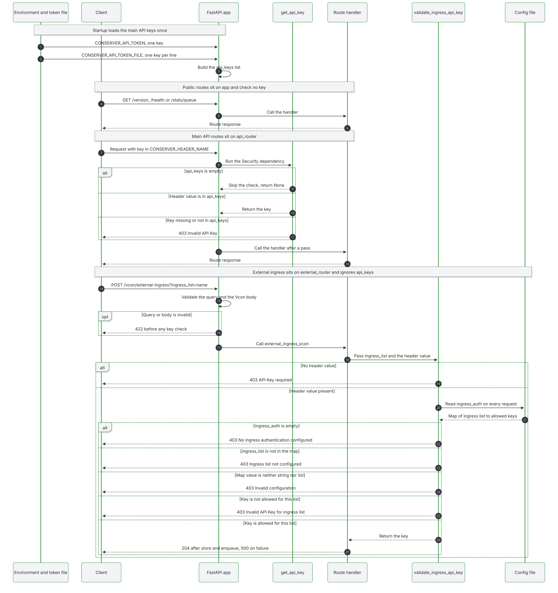

# Authentication

The API checks a key on most routes. This page shows how to set those keys, how to give an outside system a key for one ingress list, and what stays public.



## Know the three paths

| Path | Routes | Check |
|---|---|---|
| Public | `GET /version`, `GET /health`, `GET /stats/queue`, `/docs`, `/redoc`, `/openapi.json` | None |
| Main API | Every other route | The key must be in the global list |
| External ingress | `POST /vcon/external-ingress` | The key must be listed for that ingress list. Global keys do not work here |

The [API routes](../reference/api-routes.md) page gives the rule for each route.

## Set the global API keys

Set one key with an environment variable, several with a file, or both. The API joins them into one list.

```bash
CONSERVER_API_TOKEN=your-secure-token-here
CONSERVER_API_TOKEN_FILE=/etc/vcon/api_tokens.txt
```

The file holds one key per line:

```
service-token-def456
admin-token-abc123
```

The API reads both when it starts, so a change needs a restart. If the file cannot be opened, the API does not start. Keep blank lines out of the file: each line becomes a key, and a file of blank lines leaves the list non-empty, so every request fails.

!!! warning "No keys means no check"
    With neither setting in place, or with an empty file, every main API route is open. The API logs `No API keys found, skipping authentication`. External ingress stays closed.

## Send the key

Put the key in the `x-conserver-api-token` header:

```bash
curl http://localhost:8000/api/vcon \
  -H "x-conserver-api-token: your-secure-token-here"
```

`CONSERVER_HEADER_NAME` changes the header name. The API compares the whole header value with each key and does not strip a scheme, so with `Authorization` as the header, a `Bearer ` prefix must also be part of the stored key.

A missing or wrong key returns `403` with `Invalid API Key`.

## Scope a key to an ingress list

Give each outside system its own key under `ingress_auth` in `config.yml`. A key works for its listed ingress lists, on `POST /vcon/external-ingress`, and nowhere else. With no main API keys set, the main routes are open to everyone, so the scoping protects nothing there.

```yaml
ingress_auth:
  # One key
  customer_data: "customer-api-key-12345"

  # Several keys for one list
  support_calls:
    - "support-api-key-67890"
    - "support-vendor-key-xyz"
```

The API reads this section on every request, so changes need no restart.

The caller sends the key in the same header and names the list in the query:

```bash
curl -X POST "http://localhost:8000/api/vcon/external-ingress?ingress_list=customer_data" \
  -H "x-conserver-api-token: customer-api-key-12345" \
  -H "Content-Type: application/json" \
  -d '{"vcon": "0.4.0", "uuid": "018f0f2e-6c1a-8e3b-9a6d-2f4d1c7b9e10", "created_at": "2026-01-15T10:30:00Z", "parties": [], "dialog": []}'
```

Success returns `204`. The API validates the query and body first, so bad input returns `422` before any key check. After that, these errors apply:

| Status | Detail | Cause |
|---|---|---|
| 403 | `API Key required` | No header value |
| 403 | `No ingress authentication configured` | `ingress_auth` is empty or missing |
| 403 | `Ingress list '<name>' not configured` | The list is not in `ingress_auth` |
| 403 | `Invalid configuration for ingress list '<name>'` | The value is neither a string nor a list |
| 403 | `Invalid API Key for ingress list '<name>'` | The key is not allowed for this list |
| 500 | `Failed to store vCon` | The API could not store or enqueue the vCon |
| 500 | `Internal Server Error` | The configuration file cannot be read. The body is plain text |

Giving each system its own key means you can rotate or revoke one without touching the others.

## Rotate the keys

### Rotate a global key

1. Add the new key to the token file.
2. Restart the API. Both keys now work.
3. Move your clients to the new key.
4. Remove the old key from the file and restart the API again.

With Compose, `docker compose restart api` rereads a token file. A change to `CONSERVER_API_TOKEN` in `.env` needs `docker compose up -d api`. `CONSERVER_API_TOKEN` holds only one key, so a change to it has no overlap period.

### Rotate an ingress key

List both keys, wait for the client to move, then remove the old one. Neither step needs a restart.

```yaml
ingress_auth:
  customer_data:
    - "new-customer-key"
    - "old-customer-key"
```

## Generate strong tokens

```bash
openssl rand -hex 32
```

## Protect the keys

- Use different keys in each environment.
- Prefer a token file, readable only by the API's user, to a key in `.env`. In a container, mount the file and set the path.
- `ingress_auth` keys sit in plain text in `config.yml`, and `GET /config` returns them to anyone with a global key. Treat a global key as an admin key.
- Keep `/stats/queue` and the generated API pages behind your proxy if you do not want them public.
- `CORSMiddleware` allows every origin. Restrict origins at your proxy if browsers reach the API.

Serve the API over TLS. The API has no TLS or rate limiting of its own, so add both at a reverse proxy:

```nginx
limit_req_zone $binary_remote_addr zone=api:10m rate=10r/s;

server {
    listen 443 ssl;
    ssl_certificate /etc/ssl/certs/vcon.crt;
    ssl_certificate_key /etc/ssl/private/vcon.key;

    location /api {
        limit_req zone=api burst=20 nodelay;
        proxy_pass http://api:8000;
    }
}
```

To watch for failures, look for 403 responses in the API log:

```bash
docker compose logs api | grep " 403"
```

## Troubleshoot a rejected request

### The main API returns 403

Check that the running API has the key you expect. The API reads keys only at startup.

```bash
docker compose exec api env | grep CONSERVER_
```

Then check the header name, and check that the value matches the stored key in full.

### Diagnose a token file failure

```bash
ls -la /etc/vcon/api_tokens.txt
```

The path must exist inside the container, not only on the host. A bad path stops the API, so read its log first.

### External ingress returns 403

Read the detail in the response and match it to the table in [Scope a key to an ingress list](#scope-a-key-to-an-ingress-list). To see the loaded section:

```bash
curl -s http://localhost:8000/api/config \
  -H "x-conserver-api-token: $ADMIN_TOKEN" | jq .ingress_auth
```

A global key returns `Invalid API Key for ingress list`, because this route does not read the global list.
