# Build chains and pipelines

A chain is a named pipeline that a worker runs for each vCon id it pops from an ingress list. Several chains joined by lists make a pipeline. This page covers how to design them. [YAML configuration](yaml-configuration.md#build-processing-chains) lists every chain key, and the [link reference](../reference/links/index.md) lists every link.



## Declare a chain

Define links and storages once at the top level, then refer to them by name.

```yaml
links:
  transcribe_openai:
    module: links.transcribe
    options:
      vendor: openai
      vendor_options:
        OPENAI_API_KEY: your-openai-key
        model: gpt-4o-transcribe
  label_sales:
    module: links.tag
    options:
      tags:
        - department:sales

storages:
  archive:
    module: storage.s3
    options:
      aws_access_key_id: example-key
      aws_secret_access_key: example-secret
      aws_bucket: vcon-archive

chains:
  sales_calls:
    links:
      - transcribe_openai
      - label_sales
    storages:
      - archive
    ingress_lists:
      - sales_ingress
    egress_lists:
      - sales_done
```

A chain lists names only. An entry such as `- analyze: {model: gpt-4}` raises `TypeError`, and the same goes for a mapping under `storages`. To run one module with different options, define two named links.

```yaml
links:
  summarize:
    module: links.analyze
    options:
      OPENAI_API_KEY: your-openai-key
      analysis_type: summary
      prompt: Summarize this conversation in two sentences.
      source:
        analysis_type: transcript
        text_location: body.text
  find_actions:
    module: links.analyze
    options:
      OPENAI_API_KEY: your-openai-key
      analysis_type: action_items
      prompt: List the action items in this conversation.
      source:
        analysis_type: transcript
        text_location: body.text
```

Give each link the `options` it needs. A link with no `options` key receives `None` instead of its defaults, and [most modules then raise](../reference/links/index.md#declare-a-link-in-a-chain).

## Follow the run order

For each id, the worker does this:

1. Finds the chain that owns the ingress list.
2. Calls `hook.before_processing`. A falsy return skips the vCon.
3. Runs each link in order, passing the id. The [link contract](../reference/links/index.md#follow-the-link-contract) sets out the return values.
4. Pushes the id to each egress list.
5. Saves to each storage, in parallel when [parallel storage](workers.md#run-parallel-storage-writes) is on and the chain has two or more backends.
6. Calls `hook.after_processing`, on every path.

Egress comes before storage. A chain that reads the egress list can start while the save is still running, and a failed save does not take the id back.

The hooks in this repo do nothing. [Creating links](../extending/creating-links.md) covers the execution contract.

## Assign ingress lists

Each ingress list belongs to one chain. If two chains name the same list, the chain defined last in the file owns it and the other never sees that list.

To run two chains on the same vCon, put its id on two lists. `POST /vcon` accepts `ingress_lists` more than once, or a chain can push to two egress lists.

When several lists hold ids, a worker takes from the list that comes first in chain order. A busy early list can hold back a later one. See [the worker loop](workers.md#follow-the-worker-loop).

The worker ignores `enabled` on a chain. To stop a chain, remove its `ingress_lists`.

## Halt a vCon in a chain

A link stops the chain by returning a falsy value. The vCon then skips every later link, all egress lists and all storages. Its Redis copy stays until the TTL ends, and the server still counts it as processed.

These links can stop a chain on purpose:

| Link | Stops the chain when |
|---|---|
| [`sampler`](../reference/links/sampler.md) | The vCon falls outside the sample |
| [`jq_link`](../reference/links/jq.md) | The filter rejects the vCon |
| [`tag_router`](../reference/links/tag-router.md) | `forward_original` is false |

A link can also halt because the body is missing. Each link's reference page gives its return values.

Put `sampler` and `jq_link` ahead of transcription and analysis. A vCon they stop never reaches the later links, so it costs no vendor calls.

## Route vCons by tag

`tag_router` pushes the id to other lists and takes `tag_routes`, a map of tag name to list name. It reads tags that an earlier link wrote, so place it after them.

```yaml
links:
  label_urgent:
    module: links.tag
    options:
      tags:
        - urgent
  route_urgent:
    module: links.tag_router
    options:
      tag_routes:
        urgent: urgent_review
      forward_original: true
```

The push happens during the link, before this chain's storage. With `forward_original: false` the vCon stops here whether or not a route matched, so it skips this chain's storage. See the [`tag_router` reference](../reference/links/tag-router.md) for the exact cases.

## Join chains into a pipeline

An egress list feeds the next chain when its name matches that chain's ingress list. Only the id moves. Each stage works on the same Redis body.

```yaml
chains:
  stage_transcribe:
    links:
      - transcribe_openai
    ingress_lists:
      - raw_audio
    egress_lists:
      - transcribed

  stage_analyze:
    links:
      - summarize
      - label_sales
    storages:
      - archive
    ingress_lists:
      - transcribed
```

The first stage has no storage, so the vCon exists only in Redis until the second stage saves it. The TTL set at intake covers the whole pipeline. See [body TTLs](../concepts/vcon-lifecycle.md#track-the-body-ttl).

An egress list that no chain reads waits for `GET /vcon/egress`, which pops from the tail, so the newest ids come out first. A remote server can pull the same list with a [follower](yaml-configuration.md#pull-from-another-server).

## Store a vCon with no links

Use an empty `links` list to save or forward without running links. The key must be present. A chain with no `links` key sends every vCon to the dead letter queue.

```yaml
chains:
  archive_only:
    links: []
    storages:
      - archive
    ingress_lists:
      - archive_input
```

## Transcribe a recording

`transcribe` acts only on dialogs with `type` of `recording`. The text dialog in the [quick start](../getting-started/quick-start.md) passes through unchanged and counts as a success. This walkthrough needs an OpenAI key and an audio file at a URL.

Write this `config.yml`:

```yaml
links:
  transcribe:
    module: links.transcribe
    options:
      vendor: openai
      vendor_options:
        OPENAI_API_KEY: your-openai-key

storages:
  file:
    module: storage.file
    options:
      path: /data/vcons

chains:
  transcribe_chain:
    links:
      - transcribe
    storages:
      - file
    ingress_lists:
      - transcribe_input
    enabled: 1
```

Set the audio URL and its hash. The worker downloads the file, so the URL must be reachable from inside the `conserver` container, where `localhost` means the container. A vCon that refers to external media carries both `url` and `content_hash`.

```bash
export AUDIO_URL=https://your-host/recordings/call.wav
export CONTENT_HASH=sha512-$(curl -fsS "$AUDIO_URL" | openssl dgst -sha512 -binary \
  | openssl base64 -A | tr '+/' '-_' | tr -d '=')
export VCON_UUID=$(uuidgen | tr 'A-Z' 'a-z')
export NOW=$(date -u +%Y-%m-%dT%H:%M:%SZ)
```

Post a vCon with a recording dialog. Set `duration` to the real length in seconds. A dialog below the vendor's `minimum_duration` is skipped with no error.

```bash
curl -X POST "http://localhost:8000/api/vcon?ingress_lists=transcribe_input" \
  -H "Content-Type: application/json" \
  -H "x-conserver-api-token: $TOKEN" \
  -d '{
    "vcon": "0.4.0",
    "uuid": "'"$VCON_UUID"'",
    "created_at": "'"$NOW"'",
    "parties": [
      {"tel": "+15551234567", "name": "Caller"},
      {"tel": "+15559876543", "name": "Agent"}
    ],
    "dialog": [
      {
        "type": "recording",
        "start": "'"$NOW"'",
        "duration": 60,
        "parties": [0, 1],
        "mediatype": "audio/wav",
        "url": "'"$AUDIO_URL"'",
        "content_hash": "'"$CONTENT_HASH"'"
      }
    ]
  }'
```

This vCon has no `lawful_basis` attachment, and the server does not add one. See [lawful basis](../concepts/lawful-basis.md).

Read the transcript once the chain has run:

```bash
curl -s "http://localhost:8000/api/vcon/$VCON_UUID" \
  -H "x-conserver-api-token: $TOKEN" \
  | jq -r '.analysis[] | select(.type == "transcript") | .body.text'
```

No output means no transcript yet. A failed download takes about a minute to reach `DLQ:transcribe_input`. See the [dead letter queue](../operations/dead-letter-queue.md).

Vendors differ in how they find the audio and where they put the text:

| Vendor | Reads the audio from | Text in the analysis body |
|---|---|---|
| `openai` | `url` only | `body.text` |
| `deepgram` | `url` only | `body.transcript` |
| `groq` | `url` or an inline `body` | `body.text` |
| `hugging_face` | `url` or an inline `body` | Depends on the endpoint. See [transcript text](../reference/links/index.md#point-analysis-at-the-transcript-text) |

## Move to the current transcribe link

The vendor modules `links.deepgram_link`, `links.groq_whisper`, `links.hugging_face_whisper` and `links.openai_transcribe` are deprecated. The worker redirects them to `links.transcribe` and logs one warning per module. New chains should name `links.transcribe` with a `vendor`. See the [transcribe reference](../reference/links/transcribe.md).

## Handle a failure

| Failure | Result | Recovery |
|---|---|---|
| A link or `before_processing` raises | Id goes to `DLQ:<ingress_list>`. No egress or storage | `POST /dlq/reprocess` reruns the whole chain |
| Chain names a link missing from `links` | Same as above, with `KeyError` | Fix the config, then replay |
| A storage save raises | Id goes to `DLQ:storage:<backend>`. Other backends and egress are unaffected | `POST /dlq/storage/reprocess` repeats the save only |
| A tracer raises | Logged, and the chain continues, unless the tracer sets `dlq_vcon_on_error` | As for a link |

The [dead letter queue guide](../operations/dead-letter-queue.md) and [storage recovery](../operations/storage-recovery.md) give the steps.

## Add tracers

Tracers run for every link in every chain, from the top-level `tracers` key. A `tracers` list inside a chain has no effect. See [tracers in YAML](yaml-configuration.md#add-tracers) and the [JLINC tracer](../reference/tracers/jlinc.md).

!!! warning "Remove an empty tracers key"
    A `tracers:` key with nothing under it loads as `None`. The worker then raises `TypeError` before the first link, and each vCon on a chain with links goes to the dead letter queue. `example_config.yml` ships in this state, with its entries commented out. Delete the key or give it an entry.

## Troubleshoot a chain

| Symptom | Check |
|---|---|
| Nothing runs | The list name matches the submission. Another chain defined later may own the list. Worker logs may show `No ingress lists configured` |
| Every vCon reaches the DLQ | An empty `tracers` key, a missing `links` key, a link with no `options`, or a name missing from `links` |
| No storage or egress output | A link halted the chain. Look for `halted chain processing` in the logs |
| A change has no effect | [Reload timing](yaml-configuration.md#plan-for-reloads) differs by section |
| Links report a missing vCon | The body expired while the id waited |
| Chains run slowly | See [workers](workers.md) for concurrency and queue depth |
