# Egress format compatibility

The server keeps every vCon on the current spec, `vcon: "0.4.0"`. Some downstream consumers still expect an older schema. `EGRESS_FORMAT_VERSION` lets a deployment send those consumers the old format while the pipeline stays on the current one.



## Turn on the legacy format

Set the variable for both `api` and `conserver`, then restart them:

```bash
EGRESS_FORMAT_VERSION=0.0.1
```

`0.0.1` is the only supported value. Leave the variable unset or empty to emit the current spec.

The setting covers the whole deployment. There is no per-link or per-adapter option, and no way to serve one API caller the current format and another the legacy format. Use it only when every consumer of an egress point expects the legacy schema.

## Check the egress points

`lib.vcon_egress_compat.to_configured_legacy` does the conversion. These callers use it:

| Egress point | Process |
|---|---|
| `webhook` link | `conserver` |
| `postgres`, `s3` and `elasticsearch` storage adapters | `conserver` |
| `GET /vcon/{uuid}` and `GET /vcons` | `api` |

Everything else keeps the current spec:

- Redis and all link processing.
- The other storage adapters, including `mongo`, `file` and the `webhook` storage adapter. Only the `webhook` link converts.
- Egress lists, which carry vCon UUIDs and no vCon body.

## Review the field changes

For `0.0.1`, `to_legacy` works on a deep copy and makes these changes:

| Current spec | Legacy `0.0.1` | Scope |
|---|---|---|
| `vcon: "0.4.0"` | `vcon: "0.0.1"` | Top level |
| `amended` | `appended` | Top level |
| `critical` | `must_support` | Top level, dialog, analysis, attachments |
| `schema` | `schema_version` | Dialog, analysis, attachments |
| `mediatype` | `mimetype` | Dialog, analysis, attachments |
| `purpose` | `type` | Attachments, only when `type` is absent |
| `encoding: "json"` | `encoding: "none"`, with the body as a native value | Analysis, attachments |
| Keys absent | `group: []`, `redacted: {}`, `appended: null` | Top level, added only when missing |

A few rules decide the edge cases:

- When an entry carries both the current and the legacy name, the legacy value stays and the current name goes. Attachments differ for `purpose` and `type`: an attachment with both keeps both.
- A body under `encoding: "json"` is usually already a JSON value, so only `encoding` changes. A string body is parsed first. A string that is not valid JSON stays as it is, with `encoding: "json"`.
- Dialog bodies are not touched.
- Other fields, such as extension keys, pass through unchanged.

## Carry lawful basis attachments

A `lawful_basis` attachment goes through the same conversion as any other attachment. Its `purpose` becomes `type` when `type` is absent, its body keeps its content, and a JSON body changes `encoding` as above.

The conversion carries the attachment and does nothing else with it. It does not read, check or create a lawful basis. See [lawful basis](../concepts/lawful-basis.md).

## Handle an unsupported version

`to_legacy` raises `ValueError` for any other version string, at the moment of egress and not at startup. The result depends on the egress point:

| Egress point | Result |
|---|---|
| `webhook` link | The link fails and the vCon moves to the ingress dead letter queue |
| Storage adapter | The write fails and the vCon moves to `DLQ:storage:<backend>` |
| API read | HTTP 500 |

See the [dead letter queue](../operations/dead-letter-queue.md).

## Read legacy data from storage

A converted copy returns to the current spec when the server reads it back. On a Redis miss, `VconRedis.get_vcon` and the API read path both load from storage, rename the fields up, stamp `vcon: "0.4.0"` and cache the result. The canonical copy in Redis stays on the current spec.

A [follower](yaml-configuration.md#pull-from-another-server) that pulls from a server with this setting on receives the legacy format and writes it to Redis as it arrives. `VconRedis.get_vcon` renames the fields on read.
