# Configure the workers

Workers pop vCon ids from Redis and run chains. Three environment variables shape them:

```
max parallel vCons = CONSERVER_WORKERS x CONSERVER_VCON_CONCURRENCY
```

`CONSERVER_PARALLEL_STORAGE` adds a separate pool for storage writes. [Environment variables](../reference/environment.md) lists the defaults and accepted values.



## Set the process count

`CONSERVER_WORKERS` sets the number of worker processes. With `1`, the main process runs the worker loop itself. Above `1`, the main process spawns the workers and watches them.

More processes suit CPU-bound chains, since each has its own interpreter. Each process also loads its own copy of the code and modules, so memory grows with the count.

## Size the thread pool

`CONSERVER_VCON_CONCURRENCY` sets how many vCons one worker keeps in flight. At `1` the worker runs each vCon itself, one at a time. Above `1` it hands each vCon to a thread pool of that size, and it stops popping while the pool is full.

Threads suit I/O-bound chains that wait on LLM, transcription, webhook or storage calls, and they share the memory of their process.

!!! warning "Thread safety"
    Above `1`, links and hooks run in threads. Custom link code must be thread-safe. A link that holds the GIL through long CPU work slows the other vCons in that worker.

## Combine the two settings

| `CONSERVER_WORKERS` | `CONSERVER_VCON_CONCURRENCY` | Max parallel vCons | Fits |
|---|---|---|---|
| `1` | `1` | 1 | Development and debugging |
| `4` | `1` | 4 | CPU-bound chains |
| `1` | `8` | 8 | I/O-bound chains on a small host |
| `4` | `8` | 32 | I/O-bound chains at higher volume |

For a mixed workload, raise concurrency in one worker first, then add workers if the CPU has room. Measure against your own chains, since link cost varies widely.

## Run parallel storage writes

With `CONSERVER_PARALLEL_STORAGE` on, a chain with two or more storages writes to them at once, with one thread per backend. A chain with one backend writes directly. This pool starts per vCon, so peak thread use is workers times concurrency times backends.

Turn it off to write backends one at a time in chain order, for example while debugging a storage problem. A failed save goes to the storage DLQ in both modes. See [chains and pipelines](chains-and-pipelines.md#handle-a-failure).

## Choose a start method

`CONSERVER_START_METHOD` applies only when `CONSERVER_WORKERS` is above `1`. Left empty, Python's platform default applies, which is `fork` on Linux for the Python versions this project supports and `spawn` on macOS.

| Method | How a worker starts | Trade-off |
|---|---|---|
| `fork` | Copies the parent process | Lowest memory and fastest start. Can cause problems with threads and some libraries, such as OpenSSL and CUDA. See the shutdown warning below |
| `spawn` | Starts a fresh interpreter | Higher memory and slower start, and the safest with those libraries |
| `forkserver` | Forks from a clean server process | Between the two. Unix only |

Modules listed under `imports` load inside each worker, not in the main process. Followers run in the main process only, so with followers configured the parent already has timer threads when it forks. See [importing modules](yaml-configuration.md#import-extra-modules).

## Follow the worker loop

Each pass of the loop does this:

1. Rereads the config file and rebuilds the map of ingress lists to chains.
2. Calls BLPOP on all ingress lists with a 15 second timeout.
3. Runs the chain for the popped id, directly or in the pool.

BLPOP gives each id to exactly one worker. It checks lists in the order they appear across chains, so an earlier list that always has work can starve a later one.

Link and chain edits apply on the next pass, and `imports` apply only when a worker starts. See [reload timing](yaml-configuration.md#plan-for-reloads).

A popped id has no in-flight record. If a worker dies during a chain, that queue entry is lost. The body stays in Redis until its TTL ends, and `POST /vcon/ingress` can queue the id again.

## Stop the workers

On SIGTERM or SIGINT, the main process signals each live worker. With one worker, the main process is the worker. Each worker then:

1. Stops popping after the current wait, which can take up to 15 seconds.
2. Returns an id it popped during shutdown to the head of its list.
3. Finishes its current vCon, and waits for its thread pool to drain.

The main process waits up to 30 seconds for each worker, then terminates any that remain. A terminated worker loses its in-flight vCons as described above.

!!! warning "Set a stop timeout that fits your chains"
    `docker-compose.yml` sets `stop_grace_period: 5s` on the `conserver` service, so Docker kills the container before those waits end. Raise it if your chains run longer than that.

!!! warning "Shutdown under fork"
    With `fork`, each worker after the first inherits the parent's list of earlier workers. The signal handler then calls `is_alive()` on a process that is not its child, which raises `AssertionError` in that worker. The shutdown flag is already set by then, but the error lands in whatever the worker was doing. It can end the worker or fail the current vCon. `spawn` and `forkserver` do not inherit the list.

Under `docker-compose.yml`, `watchmedo` is the container's main process. It receives the `SIGTERM` from `docker compose stop` and sends `SIGINT` to the server's process group, and the server handles both signals the same way.

## Restart a failed worker

With more than one worker, the main process checks every 5 seconds and replaces any worker that died, logging `died unexpectedly, restarting`. With one worker there is no supervisor inside the process, so rely on your container or service manager.

## Scale past one process

Conservers that share a Redis server share the work, since BLPOP is atomic across them.

```bash
docker compose up -d --scale conserver=4
```

Total parallelism is then instances times workers times concurrency. Each instance also starts its own followers. For Kubernetes, see [the deployment guide](../installation/kubernetes.md).

## Watch the workers

| Signal | Source |
|---|---|
| Startup settings | Log line `Worker configuration: workers=...` |
| Queue depth | `GET /stats/queue?list_name=<list>`, or the gauge `conserver.ingress_list.length` |
| In-flight vCons per chain | `conserver.vcons.inflight` |
| Throughput and time per vCon, halted vCons included | `conserver.main_loop.count_vcons_processed`, `conserver.main_loop.vcon_processing_time` |
| Redis memory | `conserver.redis.memory_used_bytes` |

The [metrics reference](../reference/metrics.md) has the full list, and [monitoring](../operations/monitoring.md) shows how to collect it.

## Troubleshoot the workers

| Symptom | Check |
|---|---|
| Server exits at startup | An invalid `CONSERVER_START_METHOD` raises `ValueError`. An empty integer variable fails on import |
| A worker fails at startup | A module under `imports` failed to load. Worker logs show `Failed to import module` |
| Workers crash under `fork` | Try `spawn`, since some libraries do not survive a fork |
| Memory grows too high | Use fewer processes and more concurrency |
| Queue depth keeps rising | Raise concurrency for I/O-bound chains and workers for CPU-bound ones, and check the latency of outside services |
| A later list never drains | An earlier list is taking every pop. See [the worker loop](#follow-the-worker-loop) |
| Workers idle with work queued | The list name matches no chain, or a later chain took the list |
