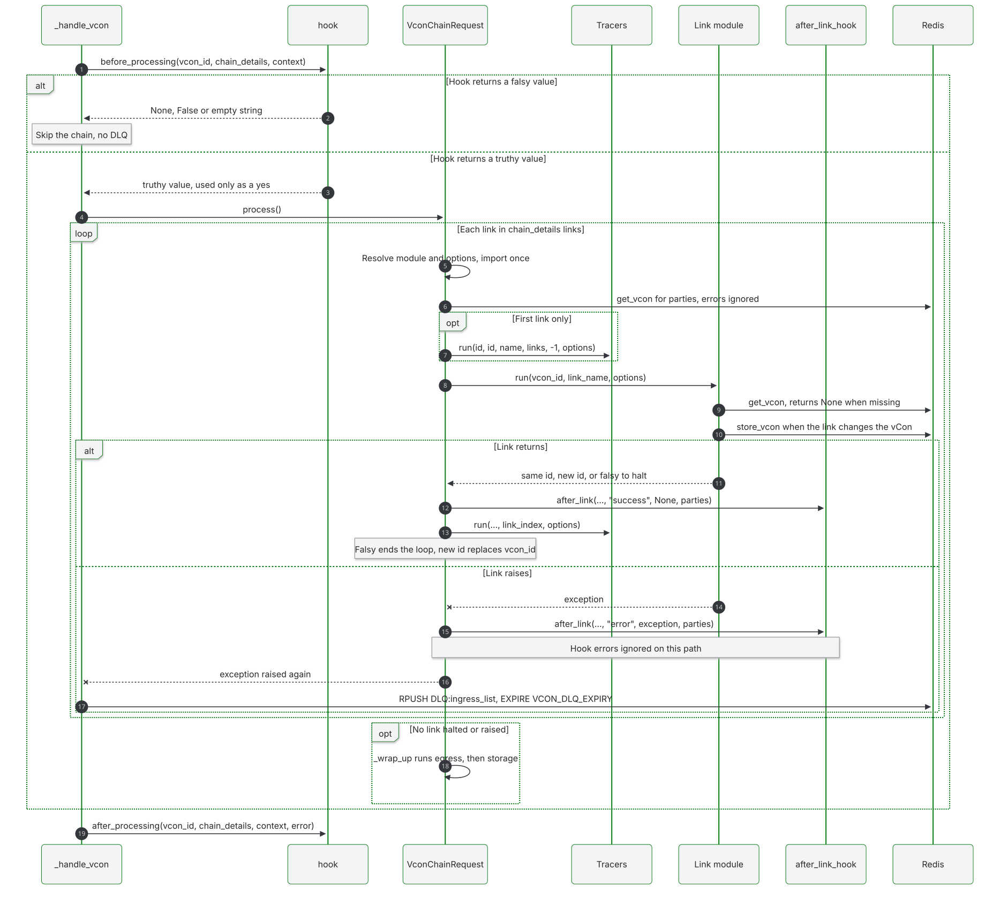

# Create a processing link

A link is one step in a chain. This page shows how to write one that the server can run, test and recover from failure. The [link reference](../reference/links/index.md) documents the links that ship with the server.

## Follow the link contract

Every link is a module with a `run` function:

```python
def run(vcon_uuid: str, link_name: str, opts: dict = default_options) -> str | None:
    ...
```

| Argument | Value |
|---|---|
| `vcon_uuid` | The id of the vCon. Load the vCon yourself |
| `link_name` | The name of this entry in `config.yml` |
| `opts` | The entry's `options`. `None` when the entry has no `options` key, because the server always passes this argument |

The sequence below shows one vCon passing through a link.



What you return decides what happens next:

| Result | Effect |
|---|---|
| The same id | The next link runs. After the last link, the vCon goes to the egress lists and then storage |
| A different id | The chain continues with that vCon. It must exist in Redis |
| `None` or another falsy value | The chain stops. No later link, egress list or storage runs for this vCon |
| An exception | The vCon moves to `DLQ:<ingress_list>`, and no later step runs |

So a link that halts also keeps the vCon out of storage. To skip your own work and let the vCon carry on, return the id.

Other points to plan for:

- A vCon can be missing, because `get_vcon` returns `None` once it has expired from Redis and no storage holds it. Return `None` in that case.
- `after_link` receives `status="success"` for a halt as well. Only the `conserver.link.count` metric separates them, with its `outcome` attribute.
- An unknown link name or a failed import raises before the `after_link` hook is set up, and the vCon reaches the dead letter queue.
- A tracer error stops the chain only when that tracer sets `dlq_vcon_on_error`. A failing tracer with no `options` key also stops the chain and sends the vCon to the DLQ, so always set `options`, even as `options: {}`.

## Lay out the module

```
conserver/links/my_link/
  __init__.py       # run() and default_options
  README.md         # Short description and a link to the reference page
  test_my_link.py   # Tests sit beside the code
```

## Write a basic link

```python
# conserver/links/my_link/__init__.py

from lib.logging_utils import init_logger
from lib.vcon_redis import VconRedis

logger = init_logger(__name__)

default_options = {
    "tag_name": "processed",
    "tag_value": "true",
}


def run(vcon_uuid, link_name, opts=default_options):
    options = {**default_options, **(opts or {})}

    vcon_redis = VconRedis()
    vcon = vcon_redis.get_vcon(vcon_uuid)
    if vcon is None:
        logger.warning("vCon %s not found, halting chain", vcon_uuid)
        return None

    vcon.add_tag(options["tag_name"], options["tag_value"])
    vcon_redis.store_vcon(vcon)

    return vcon_uuid
```

## Register the link

```yaml
links:
  my_link:
    module: links.my_link
    options:
      tag_name: custom_tag
      tag_value: custom_value

chains:
  my_chain:
    links:
      - my_link
    storages:
      - file
    ingress_lists:
      - my_list
```

This sample uses the `file` backend from the [quick start](../getting-started/quick-start.md#write-the-configuration). A name under `storages` must exist in the top-level `storages` section, or every save lands in `DLQ:storage:<name>`.

Give the chain its own list. A later chain on the same list silently replaces the earlier one. See [assign ingress lists](../configuration/chains-and-pipelines.md#assign-ingress-lists).

## Load the link

Under Compose the repository is bind mounted at `/app`, so a new module needs no build. A worker imports it on the first vCon that reaches it. `watchmedo` restarts the conserver on any `.py` save, so there is nothing to do. The restart stops the process with `SIGINT` and kills it after 10 seconds, and a killed worker loses the id it held.

Without `watchmedo`, an edit needs a restart, because a worker keeps an imported module for the life of the process.

The published images copy `conserver/` at build time, so a link added to a clone does not reach them. Build your own image. See [Bake modules into an image](dynamic-modules.md#bake-modules-into-an-image).

## Work with vCon data

`get_vcon` returns a `Vcon` object from `common/vcon.py`. `store_vcon` writes it back and keeps any existing expiry.

### Read the fields

```python
vcon.uuid
vcon.created_at
vcon.subject

for party in vcon.parties:
    tel = party.get("tel")
    email = party.get("mailto")

for dialog in vcon.dialog:
    dialog_type = dialog.get("type")  # "recording", "text", "transfer"
    body = dialog.get("body")
    url = dialog.get("url")

transcript = vcon.find_analysis_by_type("transcript")
tags = vcon.find_attachment_by_purpose("tags")
department = vcon.get_tag("department")
```

An attachment or analysis `body` with `encoding: "json"` may be a JSON value or a JSON string. `add_analysis` stores a dict or list as the value. `add_tag` writes its list as a JSON string today, and older records may hold strings too. `Vcon.decoded_body(entry)` handles both.

`find_attachment_by_purpose`, `get_tag`, `add_tag` and `add_analysis` need the `attachments` and `analysis` keys, and raise `KeyError` without them. `POST /vcon` always fills both. For a vCon from another producer, call `vcon.vcon_dict.setdefault("attachments", [])` and `vcon.vcon_dict.setdefault("analysis", [])` first.

### Add analysis

`add_analysis` takes keyword arguments only, and `vendor` is required. Pass other fields through `extra`.

```python
vcon.add_analysis(
    type="custom_analysis",
    dialog=0,
    vendor="my_vendor",
    body={"score": 0.9},
    extra={"schema": "my-schema-v1", "product": "my-product"},
)
```

A dict or list `body` is stored as is, with `encoding` set to `json`. Use `schema`, not `schema_version`.

### Add tags

```python
vcon.add_tag("status", "processed")
```

Tags live in one attachment with `purpose: "tags"`, as `name:value` strings. The `body` is a JSON string with `encoding: "json"`, not an array, so decode it with `Vcon.decoded_body` or, in `jq`, with `fromjson`.

### Add an attachment

`Vcon.add_attachment` writes only `type`, `body` and `encoding`. `store_vcon` renames `type` to `purpose`, but it does not add the other required fields. Append the entry yourself to get all of them:

```python
vcon.vcon_dict.setdefault("attachments", []).append({
    "purpose": "my_metadata",
    "start": vcon.created_at,
    "party": 0,
    "dialog": 0,
    "mediatype": "application/json",
    "encoding": "json",
    "body": {"source": "my_link"},
})
```

## Apply these patterns

### Filter vCons

```python
def run(vcon_uuid, link_name, opts=default_options):
    options = {**default_options, **(opts or {})}

    vcon = VconRedis().get_vcon(vcon_uuid)
    if vcon is None:
        return None

    required_domain = options.get("required_domain")
    if required_domain and not any(
        required_domain in party.get("mailto", "") for party in vcon.parties
    ):
        logger.info("Halting %s: no party in %s", vcon_uuid, required_domain)
        return None

    return vcon_uuid
```

To offer the `only_if` and `sampling_rate` options that other links have, use `lib.links.filters`:

```python
from lib.links.filters import is_included, randomly_execute_with_sampling

if not is_included(options, vcon) or not randomly_execute_with_sampling(options):
    return vcon_uuid
```

The [shared filter options](../reference/links/index.md#set-the-shared-filter-options) describe what they accept.

### Call an external API

Retry inside the link, then let the last error raise so the vCon reaches the dead letter queue.

```python
import requests
from tenacity import retry, stop_after_attempt, wait_exponential

default_options = {
    "api_url": "https://api.example.com/analyze",
    "api_key": "",
    "timeout": 30,
}


@retry(stop=stop_after_attempt(3), wait=wait_exponential(multiplier=1, max=10), reraise=True)
def call_api(url, api_key, data, timeout):
    response = requests.post(
        url,
        headers={"Authorization": f"Bearer {api_key}"},
        json=data,
        timeout=timeout,
    )
    response.raise_for_status()
    return response.json()


def run(vcon_uuid, link_name, opts=default_options):
    options = {**default_options, **(opts or {})}

    vcon_redis = VconRedis()
    vcon = vcon_redis.get_vcon(vcon_uuid)
    if vcon is None:
        return None

    result = call_api(options["api_url"], options["api_key"], vcon.to_dict(), options["timeout"])

    vcon.add_analysis(type="external_analysis", dialog=0, vendor="example", body=result)
    vcon_redis.store_vcon(vcon)
    return vcon_uuid
```

To send a vCon to an outside system unchanged, the bundled [webhook link](../reference/links/webhook.md) may already do what you need. A link that sends vCons out should apply `lib.vcon_egress_compat.to_configured_legacy`. See [egress compatibility](../configuration/egress-compatibility.md).

### Route to another queue

Use `VconQueue`. `enqueue` appends to the list, and a worker pops from the other end, so order holds.

```python
from lib.queue import VconQueue


def run(vcon_uuid, link_name, opts=default_options):
    options = {**default_options, **(opts or {})}

    vcon = VconRedis().get_vcon(vcon_uuid)
    if vcon is None:
        return None

    destination = options["routes"].get(vcon.get_tag("department"))
    if destination:
        VconQueue().enqueue(destination, vcon_uuid)
        logger.info("Routed %s to %s", vcon_uuid, destination)

    return vcon_uuid
```

The bundled [tag_router](../reference/links/tag-router.md) routes by tag.

### Record metrics

```python
from lib.metrics import increment_counter, record_histogram

increment_counter("conserver.link.my_link.count", attributes={"link.name": link_name})
```

Keep ids out of the attributes on histograms, because each new value creates a separate time series.

## Decide how to handle errors

| You want | Do this |
|---|---|
| Keep going without this link's result | Log it and return the id |
| Stop, with no storage and no replay | Return `None` |
| Stop, and keep the vCon for inspection and replay | Raise |

Raise when in doubt. A halted vCon leaves no queue entry, while a raised one waits in the [dead letter queue](../operations/dead-letter-queue.md) for replay.

```python
def run(vcon_uuid, link_name, opts=default_options):
    vcon_redis = VconRedis()
    vcon = vcon_redis.get_vcon(vcon_uuid)
    if vcon is None:
        return None

    try:
        result = primary_process(vcon)
    except PrimaryServiceError:
        logger.warning("Primary service failed for %s, using fallback", vcon_uuid)
        result = fallback_process(vcon)  # An error here reaches the DLQ

    vcon.add_analysis(type="process_result", dialog=0, vendor="my_vendor", body=result)
    vcon_redis.store_vcon(vcon)
    return vcon_uuid
```

## Test the link

Patch `VconRedis` where your module imports it. `pytest.ini` sets the import paths.

```python
# conserver/links/my_link/test_my_link.py

from unittest.mock import patch

from vcon import Vcon

from links.my_link import default_options, run


@patch("links.my_link.VconRedis")
def test_run_adds_tag_and_stores(mock_vcon_redis):
    vcon = Vcon.build_new()
    instance = mock_vcon_redis.return_value
    instance.get_vcon.return_value = vcon

    result = run("test-uuid", "my_link", {"tag_name": "test", "tag_value": "value"})

    assert result == "test-uuid"
    assert vcon.get_tag("test") == "value"
    instance.store_vcon.assert_called_once_with(vcon)


@patch("links.my_link.VconRedis")
def test_run_halts_when_vcon_missing(mock_vcon_redis):
    mock_vcon_redis.return_value.get_vcon.return_value = None

    assert run("missing-uuid", "my_link", {}) is None


@patch("links.my_link.VconRedis")
def test_run_uses_defaults_when_options_are_none(mock_vcon_redis):
    vcon = Vcon.build_new()
    mock_vcon_redis.return_value.get_vcon.return_value = vcon

    run("test-uuid", "my_link", None)

    assert vcon.get_tag(default_options["tag_name"]) == default_options["tag_value"]
```

Run them with `uv run pytest conserver/links/my_link`.

For a test against real Redis, mark it with `@pytest.mark.integration` so that `pytest -m "not integration"` skips it.

## Follow these practices

- Handle `opts` being `None`, and merge it over `default_options`.
- Check for a missing vCon before you use it.
- Keep each link to one job, so that chains stay easy to rearrange.
- Make `run` safe to repeat. A DLQ replay runs the whole chain again, so your link can see a vCon it already processed.
- Log the id, and never log credentials. `lib.redaction.safe_opts` strips credential-shaped options before you log or record them.
- Store once, at the end of `run`.
- Leave entries you did not write unchanged.
- Add a README with the options, and a page under `docs/reference/links/`.
