# Getting started

This section takes you from no knowledge of the server to a running stack that has processed its first vCon.

## Learn what a vCon holds

A vCon is a JSON container for one conversation, defined in an [IETF draft](https://datatracker.ietf.org/doc/draft-ietf-vcon-vcon-core/). The server works with these parts:

| Part | Contents |
|---|---|
| `parties` | The participants: phone numbers, email addresses, names |
| `dialog` | The conversation itself: recordings, text, or references to them |
| `analysis` | Output from models and services, such as transcripts and summaries |
| `attachments` | Related material, including tags and any `lawful_basis` record |

## Follow a vCon through the server

1. Your system posts a vCon to the API, which stores it in Redis and adds its uuid to one or more ingress lists.
2. A worker pops the uuid and finds the chain that reads from that list.
3. The chain runs its links in order. A link can add to the vCon, stop the chain, or send the vCon elsewhere.
4. The worker pushes the uuid to the chain's egress lists and writes the vCon to the chain's storage backends.
5. A vCon that fails goes to a dead letter queue, where you can inspect and replay it.

[vCon lifecycle](../concepts/vcon-lifecycle.md) gives the full story, and [architecture](../concepts/architecture.md) shows the services.

## Learn three terms

- A **chain** is one pipeline: ingress lists, links, storage backends and egress lists. See [chains and pipelines](../configuration/chains-and-pipelines.md).
- A **link** is one processing step, such as [transcribe](../reference/links/transcribe.md), [analyze](../reference/links/analyze.md) or [tag](../reference/links/tag.md). See the [link catalogue](../reference/links/index.md).
- A **storage adapter** copies a finished vCon to another system. See the [adapter catalogue](../reference/storage-adapters/index.md).

[Chains, links and storage](../concepts/chains-links-storage.md) explains how they fit together.

## Match a goal to its building blocks

| Goal | Building blocks |
|---|---|
| Analyse customer calls | [transcribe](../reference/links/transcribe.md), [analyze](../reference/links/analyze.md), [detect_engagement](../reference/links/detect-engagement.md), [tag_router](../reference/links/tag-router.md) |
| Keep a searchable archive | [S3](../reference/storage-adapters/s3.md) for the records, [Elasticsearch](../reference/storage-adapters/elasticsearch.md) for search |
| Search by meaning | [Milvus](../reference/storage-adapters/milvus.md) for vector similarity |
| Feed other systems | [webhook](../reference/links/webhook.md), egress lists |
| Record a tamper-evident trail | [scitt](../reference/links/scitt.md), [datatrails](../reference/links/datatrails.md), the [JLINC tracer](../reference/tracers/jlinc.md) |

The server alone does not make a deployment compliant with any regulation, and it does not manage consent. See [lawful basis](../concepts/lawful-basis.md).

## Take the next step

1. [Check the system requirements](requirements.md).
2. [Run the quick start](quick-start.md).
3. [Pick an installation method](../installation/index.md) for a real deployment.
