# vCon Server documentation

vCon Server, also called the Conserver, takes in [vCon](https://datatracker.ietf.org/doc/draft-ietf-vcon-vcon-core/) conversation records, runs them through configurable chains of processing steps and writes the results to the storage backends you choose.

These pages cover the open source server and match the code in this repository. For an introduction to the conserver, see [conserver.io](https://www.conserver.io/conserver).

## See the main functions

- **Takes in vCons.** The REST API accepts them from your systems, and scoped API keys let third parties post to one ingress list.
- **Queues work in Redis.** Plain Redis holds the vCons, the ingress and egress lists, and the dead letter queues.
- **Runs chains.** A chain names its ingress lists, its links, its storage backends and its egress lists.
- **Runs links.** A link is one step: transcription, AI analysis, tagging, routing, a webhook. Returning nothing stops the chain for that vCon.
- **Stores results.** Writes go to every backend in the chain, in parallel by default.
- **Scales by worker.** Set worker processes and per-worker concurrency with environment variables.
- **Reports on itself.** OpenTelemetry tracing and metrics, plus dead letter queues for failed vCons and failed storage writes.

The server carries `lawful_basis` attachments through the pipeline. It does not create, validate or enforce consent. See [lawful basis](concepts/lawful-basis.md) and [editions](concepts/editions.md).

## Choose a starting point

| You want to | Read |
|---|---|
| Run the server for the first time | [Quick start](getting-started/quick-start.md) |
| Learn the moving parts | [Architecture](concepts/architecture.md), [chains, links and storage](concepts/chains-links-storage.md) |
| Follow one vCon from start to finish | [vCon lifecycle](concepts/vcon-lifecycle.md) |
| Deploy it | [Installation](installation/index.md) |
| Set it up | [Configuration](configuration/index.md) |
| Run it day to day | [Operations](operations/index.md) |
| See why a conserver exists | [Conserver introduction](https://www.conserver.io/conserver/conserver-introduction) |
| Follow one phone call through the system | [Day In the Life of a vCon](https://www.conserver.io/conserver/day-in-the-life-of-a-vcon) |
| Connect your application | [Integrating Your App](https://www.conserver.io/conserver/integrating-your-app) |
| Write a link, adapter or tracer | [Extending](extending/index.md) |
| Look up a name | [Reference](reference/index.md) |
| Change the code or the docs | [Contributing](contributing.md) |

## Find the catalogues

- [Links](reference/links/index.md) lists every link module and its status.
- [Storage adapters](reference/storage-adapters/index.md) lists every backend.
- [API reference](reference/api.md) describes every REST endpoint.
- [Environment variables](reference/environment.md), [ports](reference/ports.md) and [metrics](reference/metrics.md) are generated from the code.

## Check the running version

The repository has no product version: `pyproject.toml` holds a placeholder. Each image carries the version it was built with, and `GET /version` reports it. See the [API reference](reference/api.md).

## Report a problem

Report bugs and request features in [GitHub issues](https://github.com/vcon-dev/vcon-server/issues).
