# Install vCon Server

Pick the path that fits how you will run the server. Every path ends with the same three processes: the API, the conserver workers and Redis.

## Choose a method

| Method | Runs on | Use it for |
|---|---|---|
| [Docker Compose](docker.md) | One host with Docker | Local work and small single-host deployments |
| [Automated script](automated-script.md) | One Ubuntu host | A demo host with the vcon-admin portal alongside the server |
| [Manual install](manual-installation.md) | Any host with Python and Redis | Development and debugging without containers |
| [Kubernetes](kubernetes.md) | A cluster | Scaled deployments from the published images |

The Compose file builds `docker/Dockerfile`, which holds every dependency group, bind-mounts the source and restarts the conserver on file changes. It is built for development. For production, run the published images from `docker/Dockerfile.api` and `docker/Dockerfile.conserver`. The [Docker page](docker.md#run-the-published-images) gives the image names.

The repo ships no Kubernetes manifests. The [Kubernetes page](kubernetes.md) gives an untested example to adapt.

## Know the components

| Component | Required | Role |
|---|---|---|
| API | Yes | FastAPI app on port 8000. Accepts vCons, serves reads and manages the queues |
| Conserver | Yes | Worker processes that run each vCon through its chain |
| Redis | Yes | Queues and the hot copy of each vCon. Plain Redis, no modules |
| Storage backends | No | Long-term copies. See the [storage adapter reference](../reference/storage-adapters/index.md) |

[Architecture](../concepts/architecture.md) explains how they fit together. [Ports and services](../reference/ports.md) lists every port and Compose service.

If you run an older deployment on Redis Stack, read [Migrate RedisJSON data](redis-migration.md) before you upgrade.

## Gather the prerequisites

- Read the [system requirements](../getting-started/requirements.md).
- Collect the API keys your links need. Most links take them as [options in the YAML file](../reference/links/index.md). A few fall back to an environment variable, and each link page names it.
- Choose your [storage backends](../reference/storage-adapters/index.md).

## Complete the follow-up steps

1. Check `GET /api/health`.
2. Set API keys. See [Authentication](../configuration/authentication.md). With no key set, the main API routes are open.
3. Build your [chains](../configuration/chains-and-pipelines.md).
4. Set up [monitoring](../operations/monitoring.md) and [backups](../operations/backup-restore.md).
