# Manage dead letter queues

A dead letter queue (DLQ) holds the ids of vCons that failed, so you can find the cause and replay them. This page covers the ingress DLQ. A failed write to one backend goes to a separate storage DLQ, covered in [Recover failed storage writes](storage-recovery.md).

The [API reference](../reference/api.md#work-with-dead-letter-queues) gives the parameters, responses and status codes for every route used here. In the examples, `default` stands for your ingress list and `$API` is your base URL, such as `http://localhost:8000/api`.



## Follow a failed vCon

A vCon reaches the ingress DLQ on any exception before wrap-up finishes its egress pushes. That covers a link that raises or cannot be imported, an unknown link name, a chain with no `links` key, the `before_processing` or `after_link` hook raising, a tracer with `dlq_vcon_on_error`, a failing tracer with no `options` key, and a failed egress enqueue. The worker then:

1. Logs the error with its traceback.
2. Pushes the id onto the DLQ for the ingress list it came from.
3. Sets the body's TTL to `VCON_DLQ_EXPIRY`, unless that is 0.
4. Moves on to the next vCon.

Two outcomes never reach a DLQ. A link that returns a falsy value halts the chain, and a `before_processing` hook that returns falsy skips the vCon. Neither path writes to egress or storage.

A killed worker also loses the id it was processing, since a popped id is held only in memory. See [plan maintenance](index.md#plan-maintenance).

## Name the queues

Each ingress list has its own DLQ, named `DLQ:<ingress_list>`. For example, `transcribe` fails into `DLQ:transcribe`. Each storage backend has its own queue, named `DLQ:storage:<name>`.

## Keep the vCon body

The queue holds only the id. The body stays in Redis under `vcon:<uuid>` until its TTL runs out. vCons created through the API start with a TTL of `VCON_REDIS_EXPIRY`, so without a longer retention a failed vCon could expire before you look at it. See the [environment reference](../reference/environment.md) for both defaults.

| `VCON_DLQ_EXPIRY` | Ingress DLQ | Storage DLQ |
|---|---|---|
| Above 0 | Sets the TTL to this value. This can shorten a longer TTL, and it puts a TTL on a persistent body | Raises a shorter TTL to this value. A longer TTL or a persistent body stays as it is |
| 0 | Leaves the TTL unchanged | Leaves the TTL unchanged |

!!! warning "Zero does not keep a body forever"
    With `VCON_DLQ_EXPIRY=0` the body keeps the TTL it already had, so it can expire while its id waits in the DLQ.

```bash
# Keep bodies for 14 days after a failure
VCON_DLQ_EXPIRY=1209600
```

The ingress path does not check that the body exists, so an id can sit in the DLQ after its body has gone. On replay, the read falls back to the configured storages. If no backend has the vCon, the result depends on the first link in the chain.

## Inspect the queue

```bash
# List ids. The response is a JSON array.
curl "$API/dlq?ingress_list=default" -H "x-conserver-api-token: $TOKEN"

# Read the depth. This route needs no token.
curl "$API/stats/queue?list_name=DLQ:default"

# Read the depth in Redis
docker compose exec redis redis-cli LLEN DLQ:default

# Find every DLQ, including storage DLQs and any replay locks
docker compose exec redis redis-cli --scan --pattern 'DLQ:*'
```

`GET /dlq` only reads. It removes nothing. An unknown list name returns an empty array with `200`, not an error, so a typo looks like an empty queue.

## Find the cause

```bash
# Find the log lines for one vCon
docker compose logs conserver | grep "<uuid>"

# Find every move to a DLQ
docker compose logs conserver | grep "Moving to DLQ"

# Read the vCon
curl "$API/vcon/<uuid>" -H "x-conserver-api-token: $TOKEN" | jq .
```

See [Logging](logging.md#search-the-logs) for more search patterns.

A failure can arrive late. A transcription link that keeps failing takes about a minute to reach the DLQ, and that worker handles nothing else meanwhile unless `CONSERVER_VCON_CONCURRENCY` is above 1. See [openai_transcribe](../reference/links/openai-transcribe.md#follow-the-processing-steps).

| Error | Cause | Solution |
|---|---|---|
| Connection refused | External service down | Check the service, then replay |
| Invalid API key | Wrong or expired key | Update the credentials |
| Timeout | Slow external service | Fix the service or raise the link's timeout, if it has one |
| JSON decode error | Malformed vCon | Fix the vCon data |
| Module not found | Missing dependency | Install the module |

## Replay the queue

Fix the cause first, because an unfixed failure sends the vCon straight back to the DLQ.

A replay runs every link again. Transcribe vendors skip a dialog that already has a transcript, so a transcript saved before a later link failed is not repeated. Other links repeat their work: `tag` adds a duplicate. Check each [link page](../reference/links/index.md) for its repeat behaviour.

Try one item, then the rest. `count=1` takes the oldest entry, which may not be the vCon you diagnosed:

```bash
# Move one item back to the ingress list
curl -X POST "$API/dlq/reprocess?ingress_list=default&count=1" \
  -H "x-conserver-api-token: $TOKEN"

# Watch it run
docker compose logs -f conserver

# Move up to 1000 items. The response is the number moved.
curl -X POST "$API/dlq/reprocess?ingress_list=default&count=1000" \
  -H "x-conserver-api-token: $TOKEN"
```

Each call moves a bounded number of items, oldest failure first. To drain a large queue, repeat the call until the response is 0.

The move is two Redis commands per item, not one atomic step. The server keeps no retry count, so a vCon that keeps failing returns to the DLQ each time, until you remove it.

### Replay one chosen vCon

Take its id off the DLQ, then push it back with `POST /vcon/ingress`. The route returns `204`. It logs and skips an id found neither in Redis nor in storage, so [read the vCon](#find-the-cause) first.

```bash
docker compose exec redis redis-cli LREM DLQ:default 1 "<uuid>"

curl -X POST "$API/vcon/ingress?ingress_list=default" \
  -H "Content-Type: application/json" \
  -H "x-conserver-api-token: $TOKEN" \
  -d '["<uuid>"]'
```

### Script the recovery

```bash
#!/bin/bash
# dlq-recovery.sh

set -e

INGRESS_LIST="${1:-default}"
API="${API:-http://localhost:8000/api}"
TOKEN="${TOKEN:-$CONSERVER_API_TOKEN}"

if [ -z "$TOKEN" ]; then
    echo "Set TOKEN or CONSERVER_API_TOKEN" >&2
    exit 1
fi

DEPTH=$(curl -fsS "$API/stats/queue?list_name=DLQ:$INGRESS_LIST" | jq -r .depth)
echo "DLQ:$INGRESS_LIST depth: $DEPTH"

if [ "$DEPTH" -eq 0 ]; then
    exit 0
fi

echo "Oldest failed ids:"
docker compose exec -T redis redis-cli LRANGE "DLQ:$INGRESS_LIST" 0 4

read -p "Reprocess? (y/n) " -n 1 -r
echo

if [[ $REPLY =~ ^[Yy]$ ]]; then
    curl -fsS -X POST "$API/dlq/reprocess?ingress_list=$INGRESS_LIST" \
      -H "x-conserver-api-token: $TOKEN"
    echo
    echo "Monitor processing with: docker compose logs -f conserver"
fi
```

## Remove items

```bash
# Remove one id
docker compose exec redis redis-cli LREM DLQ:default 1 "<uuid>"

# Delete the whole queue
docker compose exec redis redis-cli DEL DLQ:default
```

!!! warning "Data loss"
    These commands remove ids, not bodies. A body stays until its TTL runs out, but with no id left nothing will replay it. Investigate first.

To set an item aside instead, move its id to a list of your own. No server code reads that list, and the body still expires on its TTL. `LMOVE` moves the oldest entry, so use `LREM` and `RPUSH` for a chosen id.

```bash
# Set aside the oldest entry
docker compose exec redis redis-cli LMOVE DLQ:default ARCHIVE:default LEFT RIGHT

# Set aside a chosen id
docker compose exec redis redis-cli LREM DLQ:default 1 "<uuid>"
docker compose exec redis redis-cli RPUSH ARCHIVE:default "<uuid>"
```

## Prevent failures

**Validate input.** `POST /vcon` and `POST /vcon/external-ingress` reject a malformed body with HTTP 422 before it reaches a chain. See the [body rules](../reference/api.md#meet-the-vcon-body-rules).

**Check link timeouts.** Each link has its own options, and many have no timeout setting. See the [link reference](../reference/links/index.md).

**Decide how a custom link fails.** Raise to send the vCon to the DLQ. Return `None` only when the chain should stop, because that skips egress and storage too.

```python
def run(vcon_uuid, link_name, opts=default_options):
    try:
        # Processing logic
        return vcon_uuid
    except NotWorthProcessing:
        # Halts the chain. No DLQ entry, no egress, no storage.
        logger.warning("Halting chain for %s", vcon_uuid)
        return None
    except ServiceError:
        # Sends the vCon to the DLQ
        raise
```

See [Creating links](../extending/creating-links.md).

**Choose the tracer failure mode.** With `dlq_vcon_on_error: true`, a tracer error sends the vCon to the DLQ. The [JLINC tracer](../reference/tracers/jlinc.md#handle-a-failure) describes which failures that covers.

**Alert on depth.** See [the alert rules](monitoring.md#write-the-alert-rules).

## Work through a recovery

1. **Detect.** Alert on a depth above 0.
2. **Analyze.** Read the logs and identify the pattern.
3. **Fix.** Address the cause in the config, the code or the external service.
4. **Test.** Replay one item and watch it run.
5. **Replay.** Move the remaining items back to the ingress list.
6. **Verify.** Confirm the depth stays at 0. If items return, go back to step 2.
