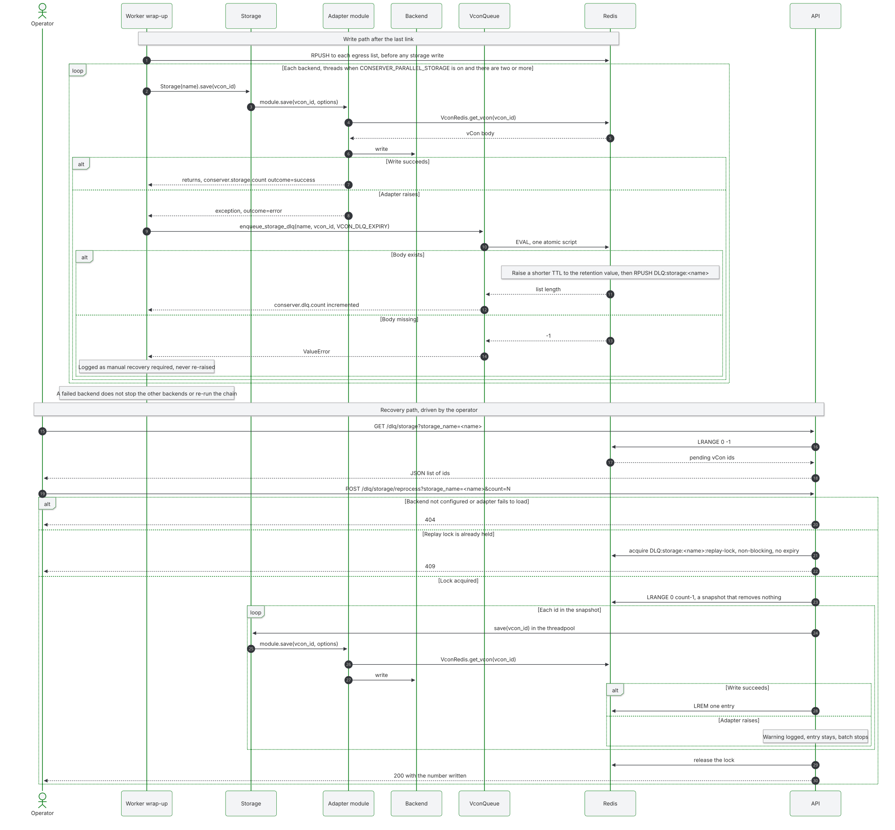

# Recover failed storage writes

This page shows how to find a failed backend write and replay it without running the chain again, so recovery never repeats transcription or analysis.



## Follow a failed write

A failed backend write enters `DLQ:storage:<configured-storage-name>`. It does not re-enter the processing chain. Other backends and egress continue, because the worker pushes to egress lists before it writes to storage. Each failed backend gets its own entry, so a vCon can sit in one storage DLQ after another backend saved it.

Watch two metrics, both described in the [metrics reference](../reference/metrics.md):

- `conserver.storage.count` with `outcome="error"`
- `conserver.dlq.count` with `queue_name="DLQ:storage:<name>"`

The `conserver.ingress_list.length` gauge samples ingress DLQs only. To read the depth of a storage DLQ, use [`GET /stats/queue`](../reference/api.md#read-queue-depth) with `list_name=DLQ:storage:<name>`, or `LLEN` in Redis.

## Keep the vCon body

The queue holds an id, and the body stays in Redis under `vcon:<uuid>`. One Redis script extends the body's retention and adds the entry, so the two steps happen together.

`VCON_DLQ_EXPIRY` sets the retention. See the [environment reference](../reference/environment.md) for its default. A shorter TTL rises to that value. A longer TTL or a persistent body stays as it is. Zero leaves the TTL unchanged, so the body can still expire on its old schedule.

If the body is missing or Redis fails, no entry is written. The worker logs `Could not durably dead-letter vCon <uuid> for storage <name>; manual recovery required` and carries on. Replay cannot reach that write. Take the UUID from the log. Once Redis is healthy and the body exists, add the entry by hand with `RPUSH DLQ:storage:<name> <uuid>`, or resubmit the vCon from its source.

Redis durability and capacity remain prerequisites. This is not a second durable store, so recover before the body expires.

## Replay the failed writes

Use the API's root path and normal authentication. In the examples, `$API` is your base URL, such as `http://localhost:8000/api`. The [API reference](../reference/api.md#work-with-dead-letter-queues) gives the parameters and status codes.

```bash
# List pending UUIDs
curl "$API/dlq/storage?storage_name=<name>" -H "x-conserver-api-token: $TOKEN"

# Retry a bounded snapshot. The response is the number written.
curl -X POST "$API/dlq/storage/reprocess?storage_name=<name>&count=10" \
  -H "x-conserver-api-token: $TOKEN"
```

Start with a small count, because the default is large. The API process runs the save itself, in its threadpool, so it needs the same configuration, credentials and network reach to the backend as the workers. A `file` backend must be a volume shared by `api` and `conserver`, or the replayed file lands in a different container and the replay still counts it as written. See [the file adapter](../reference/storage-adapters/file.md).

A `404` with `Unknown storage backend` means the backend is not configured or its adapter fails to load in the API process.

Entries leave the queue only after a successful write. A failed write stops the batch and leaves its entry queued. A stopped API process or a failed acknowledgement also leaves entries replayable.

This is at-least-once delivery. An interrupted replay can repeat a successful save, so check that the backend tolerates repeated writes of the same UUID.

## Clear a blocked entry

Replay reads from the head of the list and stops at the first failure. An entry that can never succeed therefore blocks every entry behind it, on each replay.

The usual cause is a body that has expired. `get_vcon` falls back to the configured storages on a Redis miss, unless `VCON_STORAGE_FALLBACK_ENABLED` is off, so the write can still succeed if another backend holds the vCon. If nothing holds it, most adapters raise.

```bash
# Check the first entry
docker compose exec redis redis-cli LINDEX DLQ:storage:<name> 0
docker compose exec redis redis-cli EXISTS vcon:<uuid>

# With no replay running, move that entry to the tail so the rest can drain
docker compose exec redis redis-cli LMOVE DLQ:storage:<name> DLQ:storage:<name> LEFT RIGHT
```

## Recover the replay lock

A Redis lock serializes replay per backend across API processes. A concurrent replay returns HTTP 409.

The lock deliberately has no expiry, so a slow backend cannot let a second replay acknowledge entries from an earlier snapshot. Normal completion and errors release it. A process crash leaves it in place, and every later replay then returns 409.

To recover after a crash:

1. Stop or confirm the termination of every replay for that backend.
2. Delete only `DLQ:storage:<name>:replay-lock`.
3. Retry the replay.

Never clear a lock while a replay might still be running. Preserve the DLQ list and the vCon bodies.

## Check the adapter behaviour

An adapter reaches the storage DLQ only by raising. The [storage adapter reference](../reference/storage-adapters/index.md) describes each one. Three cases matter most for recovery.

`vcon_mcp` retries transient failures itself before it raises, and respects `Retry-After`. Permanent 4xx responses are not retried. POST retries rely on the backend's UUID-based upsert. See [its options](../reference/storage-adapters/vcon_mcp.md).

`webhook` propagates HTTP 4xx and 5xx responses and transport failures to the storage DLQ. It does not retry arbitrary POST receivers, because their idempotency is unknown. With several URLs, an earlier URL may have succeeded before a later one failed, so every receiver must tolerate duplicate writes. See [its options](../reference/storage-adapters/webhook.md).

`spaceandtime` logs a failed write and returns, and `scitt` returns when the vCon is missing. Both count as a success, so neither produces a DLQ entry for those cases.

The same applies to replay: an entry for one of these adapters leaves the DLQ and counts as written even though nothing was stored. Check the body exists before you replay them, and read the log after a `spaceandtime` replay, since any error there is swallowed. `chatgpt_files` reads Redis without the `vcon:` prefix, so it uploads `null` and also counts a success.

## Validate the path before production rollout

Use an isolated Redis instance and a disposable HTTP receiver, and never create a production backend outage for this test.

1. Make the receiver return 503.
2. With `vcon_mcp`, confirm bounded retries. With `webhook`, confirm a single attempt. Then confirm a per-backend DLQ entry and a retained body.
3. Restore successful responses and replay.
4. Verify the receiver stored one UUID and no processing link ran.
5. Stop a replay during a write and confirm its UUID stays queued.

## Release the images together

Release the conserver and API images together. Deployments that build on these images must update both base images. Updating only the workers queues failures with no recovery endpoint to drain them.

Keep the previous images for rollback. A rollback must not clear `DLQ:storage:*`, and images without these routes cannot replay those queues. After rollout, verify versions, health, storage error alerts and queue depth before a small replay.
