<!-- Generated by scripts/docs/gen_ports.py. Do not edit by hand. -->

# Ports and services

!!! note "Generated page"
    `scripts/docs/gen_ports.py` builds this page from the code. Text that needs a person lives in `scripts/docs/descriptions.yml`. Edit that file, not this page.

`docker-compose.yml` joins every service to the `conserver` network, which is declared external, so create it before the first `docker compose up`. Set `COMPOSE_PROFILES` in `.env` to start optional services. A service with no published port is reachable only on that network.

## Published ports

| Service | Host port | Container port | Protocol | Host port set by |
|---|---|---|---|---|
| `api` | `8000` | `8000` | tcp | `CONSERVER_EXTERNAL_PORT` |
| `elasticsearch` | `9200` | `9200` | tcp | fixed |
| `elasticsearch` | `9300` | `9300` | tcp | fixed |
| `langfuse-server` | `3000` | `3000` | tcp | fixed |
| `postgres` | `5432` | `5432` | tcp | fixed |

## Compose services

| Service | Image | Profile | Depends on | Description |
|---|---|---|---|---|
| `api` | built from `docker/Dockerfile` | always | `redis` | FastAPI app, run by uvicorn on port 8000. |
| `conserver` | built from `docker/Dockerfile` | always | `redis` | Runs `conserver/main.py`, restarted by `watchmedo` when a Python file changes. Publishes no port. |
| `elasticsearch` | `docker.elastic.co/elasticsearch/elasticsearch:8.13.4` | `elasticsearch` | none | Single-node Elasticsearch with security on. The credentials in the Compose file are for development only. |
| `langfuse-clickhouse` | `clickhouse/clickhouse-server:24.12` | `langfuse` | none | ClickHouse store for Langfuse. Uses 8123 and 9000 on the network. |
| `langfuse-minio` | `minio/minio` | `langfuse` | none | MinIO object store for Langfuse. Uses 9000 on the network, with its console on 9001. |
| `langfuse-postgres` | `postgres:alpine` | `langfuse` | none | PostgreSQL database for Langfuse. Uses 5432 on the network. |
| `langfuse-server` | `langfuse/langfuse:latest` | `langfuse` | `langfuse-clickhouse`, `langfuse-minio`, `langfuse-postgres` | Langfuse web app for local tracing. The credentials in the Compose file are for development only. |
| `langfuse-worker` | `langfuse/langfuse-worker:latest` | `langfuse` | `langfuse-clickhouse`, `langfuse-minio`, `langfuse-postgres` | Langfuse background worker. |
| `postgres` | `postgres:alpine` | `postgres` | none | Local PostgreSQL. The credentials in the Compose file are for development only. |
| `redis` | `redis:7.4-alpine` | always | none | Plain Redis with append-only persistence and a 1 GB memory limit. Uses 6379 on the network. |

## Container and port map

