# Diagrams and motion scenes

Use these pictures to see how the open source server fits together before you read the detail. Each diagram lists the page that explains it.

Four [motion scenes](motion/index.html) animate the same flows. The Mermaid sources sit in the [diagram folder](../diagrams/README.md).

## Browse the diagram list

| ID | Diagram | SVG | Owner page | Motion |
|---|---|---|---|---|
| D01 | System context | [SVG](../diagrams/D01-system-context.svg) | [Server architecture](../concepts/architecture.md) | [M1](motion/index.html#m1) |
| D02 | Container and port map | [SVG](../diagrams/D02-container-port-map.svg) | [Ports and services](../reference/ports.md) | |
| D03 | Deploy map | [SVG](../diagrams/D03-deploy-map.svg) | [Install vCon Server](../installation/index.md) | |
| D04 | Ingress paths | [SVG](../diagrams/D04-ingress-paths.svg) | [Server architecture](../concepts/architecture.md) | |
| D05 | Chain pipeline | [SVG](../diagrams/D05-chain-pipeline.svg) | [Chains and pipelines](../configuration/chains-and-pipelines.md) | [M1](motion/index.html#m1) |
| D06 | Worker and queue topology | [SVG](../diagrams/D06-worker-queue-topology.svg) | [Workers](../configuration/workers.md) | [M2](motion/index.html#m2) |
| D07 | vCon lifecycle | [SVG](../diagrams/D07-vcon-lifecycle.svg) | [vCon lifecycle](../concepts/vcon-lifecycle.md) | [M3](motion/index.html#m3) |
| D08 | Dead letter flow | [SVG](../diagrams/D08-dead-letter-flow.svg) | [Dead letter queues](../operations/dead-letter-queue.md) | [M4](motion/index.html#m4) |
| D09 | Storage write and recovery | [SVG](../diagrams/D09-storage-write-recovery.svg) | [Storage recovery](../operations/storage-recovery.md) | [M4](motion/index.html#m4) |
| D10 | vCon assembly | [SVG](../diagrams/D10-vcon-assembly.svg) | [Lawful basis](../concepts/lawful-basis.md) | [M3](motion/index.html#m3) |
| D11 | Egress compatibility | [SVG](../diagrams/D11-egress-compatibility.svg) | [Egress format compatibility](../configuration/egress-compatibility.md) | |
| D12 | Link execution contract | [SVG](../diagrams/D12-link-execution-contract.svg) | [Create a processing link](../extending/creating-links.md) | |
| D13 | Authentication paths | [SVG](../diagrams/D13-authentication-paths.svg) | [Authentication](../configuration/authentication.md) | |
| D14 | Observability | [SVG](../diagrams/D14-observability.svg) | [Monitor the server](../operations/monitoring.md) | |

## Watch the motion scenes

Each scene has a static twin among the diagrams above.

| ID | Scene | Twin |
|---|---|---|
| [M1](motion/index.html#m1) | A vCon runs a chain | D01, D05 |
| [M2](motion/index.html#m2) | Workers drain the ingress queues | D06 |
| [M3](motion/index.html#m3) | A vCon gains analysis, tags and attachments | D07, D10 |
| [M4](motion/index.html#m4) | A failed vCon reaches the DLQ and returns | D08, D09 |

## See the system shape

**D01 System context**


**D02 Container and port map**


**D03 Deploy map**


**D04 Ingress paths**


## Follow the vCon path

**D05 Chain pipeline**


**D06 Worker and queue topology**


**D07 vCon lifecycle**


**D10 vCon assembly**


## Recover a failed vCon

**D08 Dead letter flow**


**D09 Storage write and recovery**

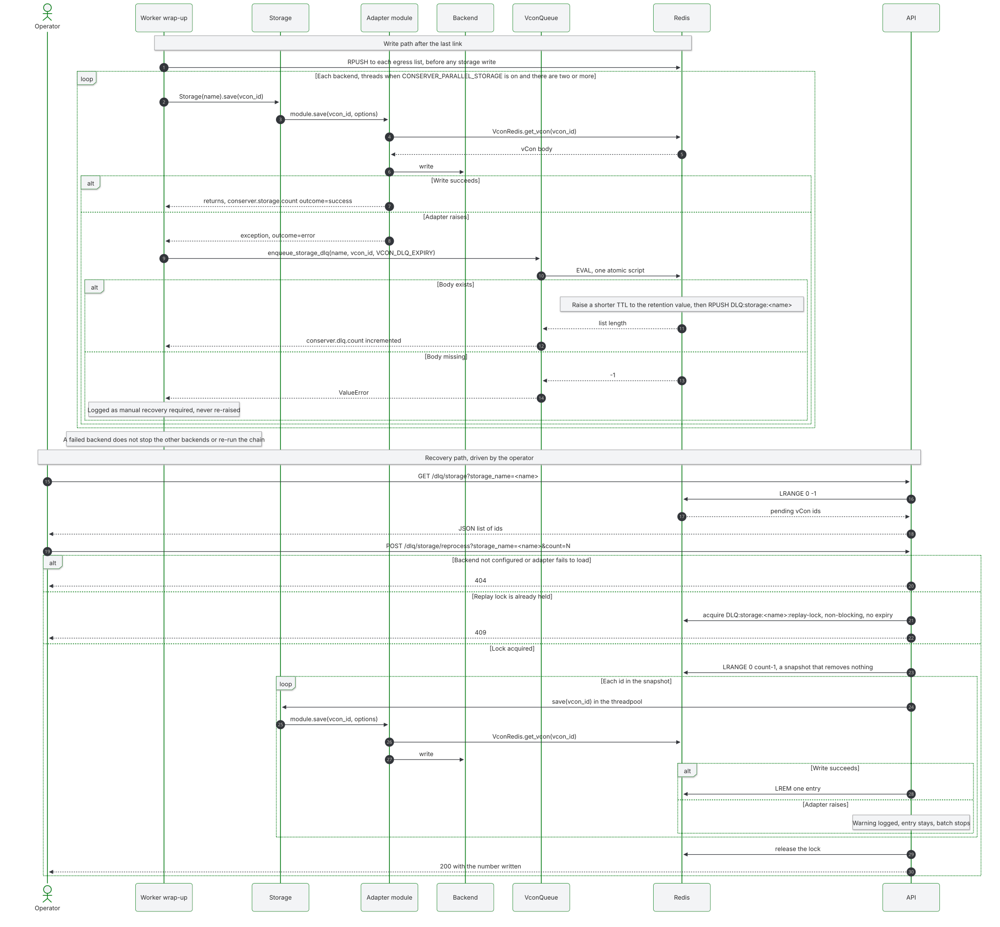

## Read the interface contracts

**D11 Egress compatibility**


**D12 Link execution contract**

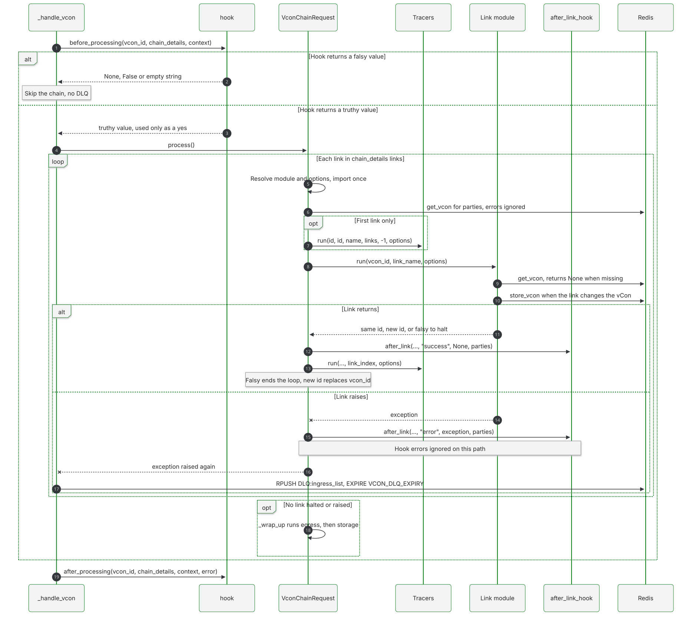

**D13 Authentication paths**

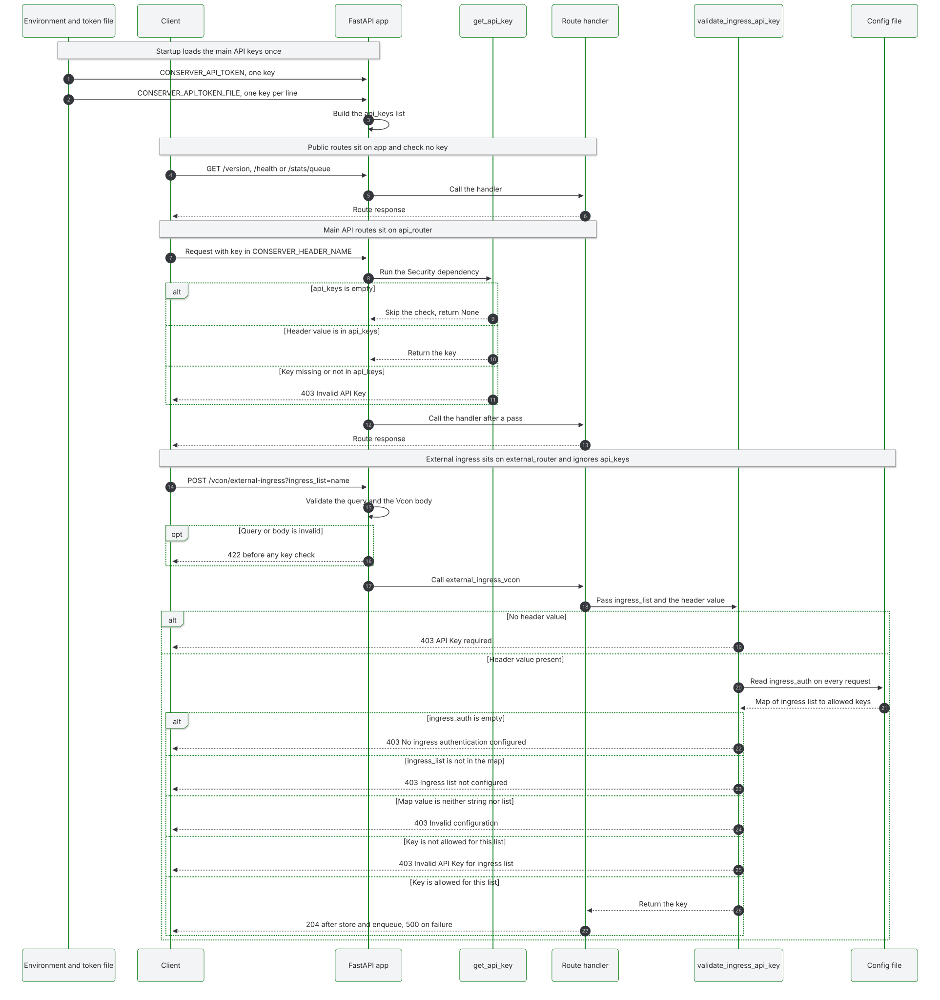

**D14 Observability**

